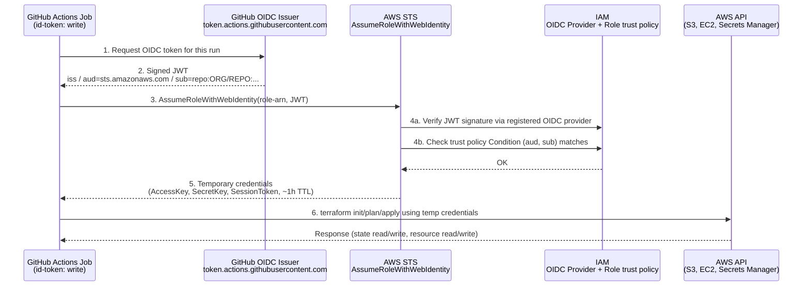
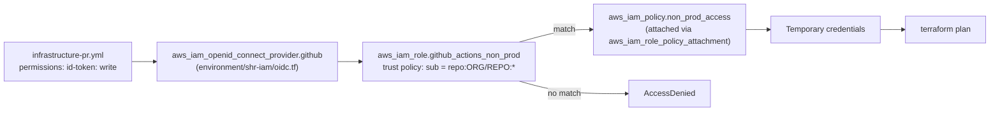
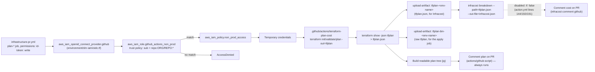

# GitHub Actions ↔ AWS OIDC Flow

How `infrastructure-pr.yml` / `infrastructure-main.yml` get AWS credentials without storing any static access key/secret key — via GitHub's OIDC identity token exchanged for temporary AWS credentials through STS.

## Sequence

## Mapped to this repo (non-prod role)

## Mapped to this repo (non-prod role + Infracost)

Same role, same trust policy, same temporary credentials as above — Infracost is just a
later step in the *same* `terraform-plan-cost` action, consuming the plan it already produced
rather than triggering any AWS/STS call of its own.

`infracost-api-key` (from `secrets.INFRACOST_API_KEY`) is passed into the action on every
plan job, but every step that would use it — `Setup Infracost`, `Generate Infracost cost
estimate`, `Comment cost on PR` — is gated `if: false`. Only the plan tree/format/plan
outcome (step M) actually posts today; re-enabling cost reporting is just flipping those
three guards back on, since `tfplan.json` is already being produced and uploaded.

## Mapped to this repo (apply role + Ansible)

Apply uses a *different* role than the non-prod role for every environment except TempStaging, and
Ansible is a later step inside that same already-credentialed `terraform-apply` job — not a
separate OIDC exchange.

```mermaid
flowchart LR
    A["infrastructure-pr.yml / infrastructure-main.yml<br/>apply-* / apply-tempstaging job"] --> B["aws_iam_openid_connect_provider.github<br/>(environment/shr-iam/oidc.tf)"]
    B --> C{"Which role does<br/>this job assume?"}
    C -->|"apply-* (main branch)"| D["aws_iam_role.github_actions_apply<br/>trust: sub=environment:*, ref=refs/heads/main"]
    C -->|"apply-tempstaging (PR)"| E["aws_iam_role.github_actions_non_prod<br/>trust: sub=repo:ORG/REPO:*"]
    D -->|match| F["aws_iam_policy.apply_access"]
    E -->|match| G["aws_iam_policy.non_prod_access<br/>+ TempStaging write carve-out"]
    D -->|"no match: ref != main"| H["AccessDenied"]
    F --> I["Temporary credentials"]
    G --> I
    I --> J[".github/actions/terraform-apply<br/>terraform init -backend-config=..."]
    J --> K["download-artifact: tfplan-bin-&lt;env-name&gt;<br/>(the exact plan reviewed on the PR)"]
    K --> L["terraform apply tfplan"]
    L --> M["AWS resources created/updated"]
    M --> N{"run-ansible == 'true'?<br/>(action.yml input, default false)"}
    N -->|"yes — only apply-tempstaging today"| O["pip install --user ansible-core"]
    O --> P["ansible-playbook playbook.yml<br/>(ansible/playbook.yml, hosts: localhost)"]
    N -->|no| Q["job ends, no Ansible step"]
```

`ansible/playbook.yml` runs with `hosts: localhost` / `connection: local` and just logs a
debug message today — it makes no AWS calls, so it doesn't exercise whichever role's policy
the job assumed. It still inherits that job's temporary credentials via the environment
variables `aws-actions/configure-aws-credentials` exports, though: a future playbook step
that *does* call AWS (e.g. `amazon.aws` collection modules) would be bound by
`apply_access` normally, or by `non_prod_access` + the TempStaging carve-out when running
inside `apply-tempstaging`.

## Summary (client-facing)

**How credentials are obtained (the sequence diagram above).** No static IAM user or long-lived access key is provisioned for CI at all. Each job requests a short-lived OIDC JWT from GitHub's issuer, then calls `sts:AssumeRoleWithWebIdentity` against the target role. STS validates the JWT signature against the OIDC provider's registered thumbprint (`aws_iam_openid_connect_provider.github`) and evaluates the role's trust policy `Condition` block against the token's `aud`/`sub` claims — signature and claims both have to check out before STS mints anything. What comes back is a session-scoped credential set (AccessKey/SecretKey/SessionToken) capped at the role's max session duration (~1h), permissioned to exactly the policy attached to that role. There's no key rotation problem to manage because there's no standing key in the account's IAM surface to rotate.

**How the access decision is made (the flowchart above, non-prod role).** Access to the AWS role is controlled by the IAM trust policy, rather than by the workflow itself. This ensures that only authorized GitHub Actions workflows can obtain the temporary credentials needed to run `terraform plan`.

The trust policy checks whether the JWT `sub` matches `repo:ORG/REPO:*`. If it matches, AWS STS allows the workflow to assume the role and provides temporary credentials with limited permissions: reading the S3 Terraform state (state locking is S3-native via `use_lockfile`, no DynamoDB table involved), listing Secrets Manager secret names to discover customers/envs, and — as a scoped exception — writing TempStaging's own state key and example bucket/security group (see "TempStaging apply/destroy" below). These permissions are sufficient for `terraform plan` on every environment, plus `apply`/`destroy` on TempStaging specifically, but do not allow any other environment's resources to be created, modified, or destroyed.

If the JWT does not match, STS rejects the request with `AccessDenied` before the IAM permissions policy is evaluated. Therefore, a workflow-level bug cannot expand the role's access. IAM is the enforcement boundary, ensuring that access is restricted regardless of what the pipeline does.

The apply role's trust policy is a single statement: any `sub` matching `repo:ORG/REPO:environment:*` is allowed **only if** the token's `ref` claim is also `refs/heads/main`. There is no PR-time exception on this role anymore — every apply/destroy job for every environment other than TempStaging goes through this role, and a PR-triggered run always gets `AccessDenied` at the trust-policy step, not just a review flag.

## TempStaging apply/destroy — the one exception

TempStaging is a real per-PR environment (`apply-tempstaging`/`destroy-tempstaging` in `infrastructure-pr.yml`), so it needs write access from a `pull_request`-triggered run — which the main-branch-only apply role can never grant. Rather than carving out another PR-time exception on the apply role's trust policy, TempStaging's apply/destroy reuses the **non-prod** role instead: `non_prod_access` (`environment/shr-iam/github_actions.tf`) carries a small set of TempStaging-scoped write statements (tfstate write under the `tempstaging/*` key prefix, full lifecycle on the `my-example-test-bucket-12345-tempstaging-pr*` bucket, and — unavoidably, since EC2 doesn't support resource-level ARN scoping for these actions — unscoped security-group create/delete/authorize/revoke).

That last point matters: because the non-prod role's trust condition is the broad `repo:ORG/REPO:*` (below), *every* `plan-*` job across *every* environment can assume this role — so the TempStaging security-group actions are reachable by any of them, not just `plan-tempstaging`. The bucket and tfstate statements are scoped tightly enough by resource ARN that this doesn't apply to them, but the security-group statement is an accepted, explicitly-flagged tradeoff of merging plan+apply into one role for TempStaging.

## Does this already support both "on PR" and "on merge to main"?

Yes — both `infrastructure-pr.yml` (event `pull_request`) and `infrastructure-main.yml` (event `push` to `main`) assume the same two roles, and this already works today without needing to special-case either trigger.

Per GitHub's own rule (see Key points below), declaring `environment:` on a job overrides whatever `sub` format the triggering event would otherwise produce. Almost every job in both workflows declares `environment:` (`<tier>-plan` for plan jobs, the bare tier/customer name for apply jobs), **except** `discover-customers` and `discover-demo-envs` (present in both workflow files, used to build the customer/env matrix from Secrets Manager) — those two assume the non-prod role with no `environment:` at all, so they keep whatever `sub` the trigger event itself produces:

| Job | Trigger event | `sub` claim actually produced |
|---|---|---|
| `plan-shr` (in `infrastructure-pr.yml`) | `pull_request` | `repo:ORG/REPO:environment:shr-iam-plan` — **not** `...:pull_request` |
| `plan-staging-global` (in `infrastructure-main.yml`) | `push` to `main` | `repo:ORG/REPO:environment:staging-stg-admin-plan` — **not** `...:ref:refs/heads/main` |
| `apply-prod-customers` | `push` to `main` | `repo:ORG/REPO:environment:prod-<customer>` |
| `apply-tempstaging` (assumes the **non-prod** role, not apply) | `pull_request` | `repo:ORG/REPO:environment:tempstaging` |
| `discover-customers` (in `infrastructure-pr.yml`) | `pull_request` | `repo:ORG/REPO:pull_request` — no `environment:` declared |
| `discover-customers` (in `infrastructure-main.yml`) | `push` to `main` | `repo:ORG/REPO:ref:refs/heads/main` — no `environment:` declared |
| `discover-demo-envs` (both workflows) | same as above per file | same as `discover-customers` above |

So both sub *families* genuinely occur in this pipeline: environment-scoped subs for every plan/apply job that declares `environment:`, and the plain `pull_request` / `ref:refs/heads/main` subs for the two `discover-*` jobs that don't. A trust policy written as a `StringLike` list of exactly `pull_request` + `ref:refs/heads/<branch>` (the pattern that's enough for a plain repo without GitHub Environments) would work for `discover-*` but **block every environment-scoped job** — the opposite problem also applies.

That's why the two roles here are wildcarded the way they are instead:

- **Non-prod role** (`github_actions_non_prod`, mostly read-only) — `sub` condition is the broad `repo:ORG/REPO:*`. This has to match *any* sub format, because it's genuinely assumed with all three shapes: `environment:*-plan` (the matrix plan jobs), `environment:tempstaging` (`apply-tempstaging`/`destroy-tempstaging`), `pull_request`, and `ref:refs/heads/main` (the two `discover-*` jobs, on PR and on main respectively). The blanket wildcard is paired with a narrow, resource-scoped TempStaging write carve-out on the attached policy (see "TempStaging apply/destroy" above) rather than broadening the trust condition itself.
- **Apply role** (`github_actions_apply`, read-write) — single statement, no PR-time exception: any environment-scoped `sub` is allowed only when the run's `ref` is also `refs/heads/main`. Tighter than the non-prod role on purpose, since this role can create/modify real infrastructure for every environment except TempStaging — and it's the trust policy itself, not review discipline, that keeps every apply/destroy job for those environments off of pull requests.

Net effect: no change is needed to run plan/apply on both PR and merge-to-main — that's already the current behavior of `environment/shr-iam/oidc.tf`. Narrowing the non-prod role's condition to `repo:ORG/REPO:environment:*` is **not** a safe hardening as things stand — it would immediately break `discover-customers` and `discover-demo-envs` in both workflows, since neither declares `environment:`. Doing that safely would mean adding `environment: shr-iam-plan` (or similar) to those two jobs first, then narrowing the trust policy — not the other way around.

## Key points

- **No long-lived secrets.** Nothing but a `role-arn` is stored in GitHub — no `AWS_ACCESS_KEY_ID`/`AWS_SECRET_ACCESS_KEY` secret exists for either role.
- **`permissions: id-token: write` is what makes step 1 possible.** Without it, GitHub never issues a token and `aws-actions/configure-aws-credentials` fails immediately.
- **The trust policy's `Condition` is the actual access control**, not the OIDC provider itself — the provider only proves the token is genuinely from GitHub; the `sub`/`aud` match is what decides *which* repo/branch/environment is allowed to assume *that* role.
- **`sub` format depends on how the job is triggered:**
  - push to a branch → `repo:ORG/REPO:ref:refs/heads/<branch>`
  - `pull_request` event → `repo:ORG/REPO:pull_request`
  - job declares `environment:` → `repo:ORG/REPO:environment:<name>` (overrides the two above)
- Credentials returned by STS are temporary (default ~1 hour) and scoped to exactly the IAM policy attached to the assumed role.
- **One role per job, no re-assuming mid-run.** Each job calls `configure-aws-credentials` exactly once — `discover-customers`/`discover-demo-envs`/every `plan-*` job assumes `github_actions_non_prod`, every `apply-*`/`destroy-*` job assumes `github_actions_apply`, **except** `apply-tempstaging`/`destroy-tempstaging`, which also assume `github_actions_non_prod` (its TempStaging write carve-out) instead of `github_actions_apply` — but never more than one role in the same job. Nothing in that job's steps can pivot to a *different* role afterward: both `non_prod_access` and `apply_access` (the policies attached in `main.tf`) carry an explicit `DenyRoleChaining` statement (`Deny` on `sts:AssumeRole`, resource `*`) — an explicit Deny always wins AWS's policy evaluation, so even if some other policy were attached to either role later that granted `sts:AssumeRole`, chaining into a different role would still be blocked. Going from plan to apply always means a *separate* job with its own OIDC exchange, gated by its own GitHub Environment (e.g. `tempstaging-plan` → `tempstaging`) — never a role switch inside one running job.
