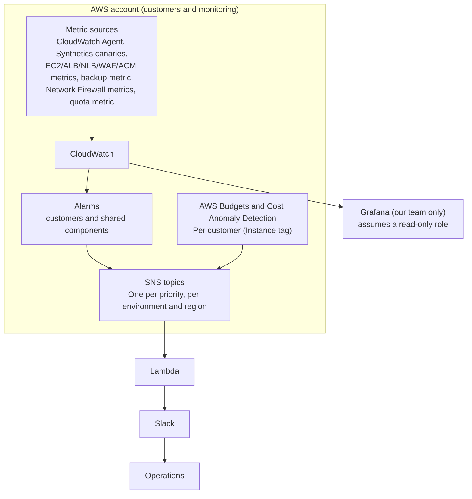
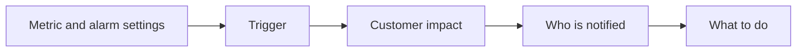
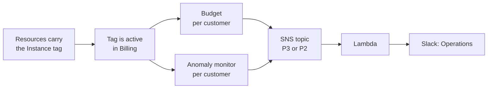
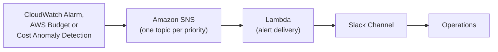

# Monitoring & Alerting — Hosted Lighthouse Customer Environments

Monitoring and alerting standard for every hosted Lighthouse customer environment: what's monitored, the trigger conditions, who's notified, and the expected response. Deployed automatically at provisioning via Terraform.

**Goal:** detect and respond to issues before customers report them.

## Overview

This section shows how monitoring data flows from the AWS account to Slack, and lists the components and metrics that are monitored.



| Component | Metric |
| --- | --- |
| Lighthouse EC2 instance | `StatusCheckFailed`, `CPUUtilization` (detailed monitoring), `NetworkOut`, `mem_used_percent`, `disk_used_percent` |
| Monitoring agent | `mem_used_percent` (sample count, as heartbeat) |
| EBS volumes | `StatusCheckFailed_AttachedEBS`, `EBSReadBytes`, `EBSWriteBytes`, `EBSReadOps`, `EBSWriteOps` (disk read and write; Nitro instances) |
| Application Load Balancer (ALB, private) | `UnHealthyHostCount`, `TargetResponseTime` (p95), `RequestCount` (request rate), `HTTPCode_Target_5XX_Count`, `HTTPCode_ELB_5XX_Count` |
| Network Load Balancer (NLB, public) | `UnHealthyHostCount`, `ActiveFlowCount` (both for the OpenVPN target group) |
| AWS WAF (on the ALB) | `BlockedRequests` |
| AWS Network Firewall (shared, Management VPC) | `DroppedPackets` |
| ACM certificates | `DaysToExpiry` |
| Customer domain (DNS, TLS, HTTP) | `SuccessPercent` (HTTPS canary on port 443, expects HTTP 200) |
| Lighthouse application | `SuccessPercent` (workflow canary) |
| Daily AMI snapshots | `SnapshotSucceeded` (custom metric) |
| Monitoring pipeline (alert delivery Lambda) | `Errors`, `Throttles` |
| Monitoring pipeline (SNS alert topics) | `NumberOfNotificationsFailed` |
| Shared quotas, per region (AWS WAF: web ACLs, rule groups, IP sets, regex pattern sets; others only if AWS publishes a usage metric) | `AWS/Usage` `ResourceCount` (published by AWS, no Lambda); usage % = `ResourceCount / limit × 100` (metric math; `SERVICE_QUOTA()` instead of the fixed limit where the service supports it) |
| Cost per customer (visibility) | Monthly cost by `Instance` tag, viewed in Cost Explorer in the Billing console (not a CloudWatch metric) |
| Cost per customer (budget alerts) | Monthly actual and forecasted cost, filtered by the customer's `Instance` tag (AWS Budgets), and cost anomalies per customer (Cost Anomaly Detection). Neither is a CloudWatch metric |

## Monitoring Categories

The monitoring of the Lighthouse platform is classified into several categories. Each category defines the metric and alarm configuration, the trigger, the customer impact, who is notified and what action is required.



### Availability & Health Checks

| Metric | Namespace & Dimensions | Trigger | Customer Impact | Priority | Notify | Response Action | Why It Matters |
| --- | --- | --- | --- | --- | --- | --- | --- |
| `StatusCheckFailed` (instance) | `AWS/EC2`; `InstanceId` | Max, 60 s; 3 of 3 ≥ 1 (3 min); missing: `missing` (INSUFFICIENT_DATA, no alert) | Instance unreachable; application likely down | P1 | Operations | Check which status check failed in the EC2 console. System failure: stop and start the instance, escalate to Engineering. Instance failure: review the system log, reboot | Catches a failed instance even when the canary cannot say why |
| `SuccessPercent` (HTTPS canary) | `CloudWatchSynthetics`; `CanaryName` | Canary calls `https://<customer domain>` on 443 every 1 min and passes on HTTP 200. Avg, 60 s; 3 of 3 < 100 (3 min); missing: breaching | Service unreachable | P1 | Operations | Read the failure reason in the Synthetics run results and check that layer (DNS, TLS, WAF, load balancer, application) | One check as the customer sees it |
| `UnHealthyHostCount` (ALB) | `AWS/ApplicationELB`; `LoadBalancer`, `TargetGroup` | Min, 60 s; 3 of 3 ≥ 1 (3 min); missing: not breaching | Application unavailable | P1 | Operations | Open the target group in the EC2 console for the health reason; check the instance and recent deploys | The load balancer can be up while its only target fails the health check |
| `HTTPCode_Target_5XX_Count`, `HTTPCode_ELB_5XX_Count`, `RequestCount` (ALB) | `AWS/ApplicationELB`; `LoadBalancer` | (Target 5xx + ELB 5xx) ÷ requests × 100, metric math. Sum, 60 s; 5 of 5 > 5% with at least 50 requests a minute (5 min); missing: not breaching | Users receive errors | P2 | Operations | Target 5xx: check the app logs. Load balancer 5xx: check target health. Roll back if errors follow a release | Catches an application failing while health checks pass |
| `SuccessPercent` (workflow canary) | `CloudWatchSynthetics`; `CanaryName` | Canary runs every 5 min. Avg, 300 s; 2 of 2 < 100 (10 min); missing: breaching | Early warning of a failing workflow | P2 | Operations | Review the canary results and the failing step | Catches workflow failures before customers do |
| `StatusCheckFailed_AttachedEBS` | `AWS/EC2`; `InstanceId` | Max, 60 s; 3 of 3 ≥ 1 (3 min); missing: `missing` (INSUFFICIENT_DATA, no alert) | Disk I/O stalled; instance may hang | P2 | Operations | Check the volume status; wait for AWS recovery or replace the volume. Available only on Nitro instances | The instance check can pass while a volume is impaired |

### Performance & Capacity

| Metric | Namespace & Dimensions | Trigger | Customer Impact | Priority | Notify | Response Action | Why It Matters |
| --- | --- | --- | --- | --- | --- | --- | --- |
| `CPUUtilization` | `AWS/EC2`; `InstanceId` | Avg, 60 s (needs detailed monitoring); 15 of 15 > 70 warning; 10 of 10 > 90 critical; missing: not breaching | Slower responses | P3 (> 70), P2 (> 90) | Operations | Review the load on the Infrastructure dashboard | Early warning before response times degrade |
| `mem_used_percent` | `CWAgent`; `InstanceId` | Avg, 60 s; 15 of 15 > 70 warning; 10 of 10 > 85 critical; missing: not breaching | Instability or restarts | P3 (> 70), P2 (> 85) | Operations | Review memory use on the dashboard; restart the service | Flags leaks before instability |
| `disk_used_percent` | `CWAgent`; `InstanceId`, `path`, `device`, `fstype` (one alarm per mount point, listed in Terraform) | Avg, 300 s; 3 of 3 > 80 warning, > 90 critical; missing: not breaching | Disk-full risk | P3 (> 80), P2 (> 90) | Operations | Find large files and the growth trend; clear temporary or log files | Prevents disk-full outages |
| `TargetResponseTime` (ALB) | `AWS/ApplicationELB`; `LoadBalancer` | p95, 60 s; 10 of 10 > 0.3 s; missing: not breaching | Slow application | P2 | Operations | Check CPU, memory, recent deploys and target health | Slowness often comes before an outage |
| `RequestCount` (ALB) | `AWS/ApplicationELB`; `LoadBalancer` | Sum, 60 s; 10 of 10 above the anomaly band (width 3); missing: not breaching | Traffic surge or attack | P3 | Operations | Check the traffic source in the WAF metrics; confirm a surge with the customer | Counts only requests for which the load balancer chose a target |
| `NetworkOut` | `AWS/EC2`; `InstanceId` | Sum, 300 s; 6 of 6 above the anomaly band (width 3) (30 min); missing: not breaching | Higher cost; unusual outbound traffic | P3 | Operations | Find the traffic driver (destination, volume); confirm with the customer | Counts all outbound bytes, including web and VPN responses |
| `mem_used_percent` (agent heartbeat) | `CWAgent`; `InstanceId` | Sample count, 300 s; 2 of 2 < 1 (10 min); missing: breaching | Memory and disk alarms stop working | P2 | Engineering | Check and restart the agent service; verify the IAM role | Missing data can look healthy |

#### Disk I/O (dashboard only, no alarm)

These EBS metrics have no alarm. They are shown on the [Grafana](#grafana-dashboards) "Infrastructure" dashboard to investigate slowness or high disk load.

| Metric | Namespace & Dimensions | Statistic | Panel | Why It Matters |
| --- | --- | --- | --- | --- |
| `EBSReadBytes` | `AWS/EC2`; `InstanceId` (Nitro instances only) | Sum, 300 s (divide by the period for throughput) | Infrastructure: disk read (bytes) | Shows read throughput; helps explain slow responses or high CPU wait |
| `EBSWriteBytes` | `AWS/EC2`; `InstanceId` (Nitro instances only) | Sum, 300 s (divide by the period for throughput) | Infrastructure: disk write (bytes) | Shows write throughput; helps spot log growth or backup load |
| `EBSReadOps` | `AWS/EC2`; `InstanceId` (Nitro instances only) | Sum, 300 s (divide by the period for IOPS) | Infrastructure: disk read (operations) | Shows read IOPS; helps detect volume limits being reached |
| `EBSWriteOps` | `AWS/EC2`; `InstanceId` (Nitro instances only) | Sum, 300 s (divide by the period for IOPS) | Infrastructure: disk write (operations) | Shows write IOPS; helps detect volume limits being reached |

### Remote Access (OpenVPN via NLB)

| Metric | Namespace & Dimensions | Trigger | Customer Impact | Priority | Notify | Response Action | Why It Matters |
| --- | --- | --- | --- | --- | --- | --- | --- |
| `UnHealthyHostCount` (NLB, OpenVPN) | `AWS/NetworkELB`; `LoadBalancer`, OpenVPN `TargetGroup` | Max, 60 s; 3 of 3 ≥ 1 (3 min); missing: not breaching | VPN connections impossible | P1 | Operations | Check the instance and the OpenVPN service; confirm the health check port matches the customer's port | The OpenVPN target group has one host, so one unhealthy host means no VPN; `Maximum` is used so that a node without a target in its own zone (NLB cross-zone is off by default) cannot hide it |
| `ActiveFlowCount` (NLB, OpenVPN) | `AWS/NetworkELB`; OpenVPN `TargetGroup` | Avg, 300 s; 3 of 3 below the anomaly band (width 3) (15 min); missing: not breaching | Devices disconnected | P2 | Operations | Check the OpenVPN logs and recent port or configuration changes | Shows a VPN problem when target health passes |

### Web Protection & Certificates

| Metric | Namespace & Dimensions | Trigger | Customer Impact | Priority | Notify | Response Action | Why It Matters |
| --- | --- | --- | --- | --- | --- | --- | --- |
| `BlockedRequests` (WAF) | `AWS/WAFV2`; `WebACL`, `Rule` = `ALL`, `Region` | Sum, 300 s; 2 of 2 above the anomaly band (width 3) (10 min); missing: not breaching | Attack, or legitimate traffic blocked | P3 | Operations | Check the blocking rule and source IPs against the customer allowlist; unblock if legitimate | A spike is an attack or a wrongly blocked customer |
| `DroppedPackets` (Network Firewall) | `AWS/NetworkFirewall`; `FirewallName`, `AvailabilityZone`, `Engine` (`Stateful`, `Stateless`) | Sum of the AZ and engine metrics added with explicit metric math (`m1+m2+…`, same 300 s period; AWS allows at most 10 metrics and math expressions in such an alarm); 2 of 2 above the anomaly band (width 3) (10 min); throttled packets are not included; missing: not breaching | Attack, or legitimate traffic blocked | P3 | Operations, Engineering | Check the firewall logs for the rule group, source and destination; allow the traffic if legitimate | One shared firewall serves every customer |
| `DaysToExpiry` (ACM certificate) | `AWS/CertificateManager`; `CertificateArn` | Min, 1 day; < 30 days warning, < 7 days critical; missing: breaching | Certificate errors; outage once expired | P2 (warning), P1 (critical) | Operations | Check the ACM renewal status and the DNS validation record; renew manually if needed | ACM renews DNS-validated certificates automatically when 45 days remain |

### Platform Health & Capacity

Backups, shared quota limits, and the alert delivery path itself. The alert delivery Lambda, the alert topics and the alarms on them belong to the monitoring deployment of each environment and region. A failure in the Lambda or SNS would silence every other alert, so the pipeline alerts should reach Engineering through a path that does not depend on the alert delivery Lambda.

| Metric | Namespace & Dimensions | Trigger | Customer Impact | Priority | Notify | Response Action | Why It Matters |
| --- | --- | --- | --- | --- | --- | --- | --- |
| `SnapshotSucceeded` (AMI snapshot) | `Lighthouse/Backup` (custom); `Customer` | Sum, 1 h; 25 of 25 < 1 (P1); missing: breaching | Recovery point at risk | P1 (25 h) | Engineering | Check job errors, IAM permissions and snapshot quota; rerun the job | Failed backups must be noticed |
| Quota usage % (AWS WAF web ACLs, rule groups, IP sets, regex pattern sets per region; more in `var.quotas`) | `AWS/Usage`; the dimensions of each usage metric (WAF: `Resource`) | Max, 300 s; usage / limit × 100; 1 of 1 > 80 (P3), > 95 (P2); missing: not breaching | New customers cannot be provisioned | P3 (80%), P2 (95%) | Operations, Engineering | Request a quota increase | These quotas are regional and shared by the account, so one limit affects every customer |
| `Errors` (Lambda) | `AWS/Lambda`; `FunctionName` | Sum, 300 s; 1 of 1 ≥ 1; missing: not breaching | Alerts may not reach Slack | P2 | Engineering | Check the Lambda logs; fix the Lambda or the Slack credentials | Unformatted alerts are lost |
| `Throttles` (Lambda) | `AWS/Lambda`; `FunctionName` | Sum, 300 s; 1 of 1 ≥ 1; missing: not breaching | Alerts delayed or dropped | P2 | Engineering | Check the Lambda concurrency and alert volume | Throttling drops alerts |
| `NumberOfNotificationsFailed` (SNS) | `AWS/SNS`; `TopicName` (each priority topic of the deployment) | Sum, 300 s; 1 of 1 ≥ 1; missing: not breaching | Alerts not delivered to the Lambda | P2 | Engineering | Check the subscription, permissions and topic policy | Confirms SNS reached the Lambda |

### Cost Monitoring

Cost is split per customer by the `Instance` tag. Every resource of a customer carries it, and its value is different for each customer (`CostCenter` is shared between customers, so it is not used). The tag must be **active** in Billing. If it is not active, budgets show zero cost and never alert.

An administrator creates one budget and one cost anomaly monitor per customer. Alerts reach Slack (Operations) through the same SNS topics and Lambda as the alarms.



#### Visibility

Cost visibility needs no code. Use **Cost Explorer** in the AWS Billing and Cost Management console.

1. Check that the `Instance` tag is **Active** under **Cost allocation tags**.
2. Open **Cost Explorer**. Set the date range and **Monthly** granularity.
3. Set **Group by** to **Tag**, then `Instance`. Each line is one customer. A line with an empty tag is cost that has no tag.
4. To see one customer, add a **Filter** on **Tag**, `Instance`, and the customer's value.
5. Choose **Save as** to keep the report.

Use the payer account, or this account if it stands alone. Menu names may differ a little in the console.

#### Budget alerts

| Metric | Namespace & Dimensions | Trigger | Customer Impact | Priority | Notify | Response Action | Why It Matters |
| --- | --- | --- | --- | --- | --- | --- | --- |
| Budget, actual cost (80%) | AWS Budgets; filter on the customer's `Instance` tag | Monthly. Actual cost above 80% of the budget | None; cost risk | P3 | Operations | Check the spend by tag in Cost Explorer | Early warning |
| Budget, forecast | AWS Budgets; same filter | Forecast above 100% of the budget | None; cost risk | P3 | Operations | Compare forecast and budget; adjust if needed | Warns before overspend |
| Budget, actual cost (100%) | AWS Budgets; same filter | Actual cost above 100% of the budget | None; budget spent | P2 | Operations | Find the cause; confirm with the customer owner | Budget is already spent |
| Cost anomaly | AWS Cost Anomaly Detection; one monitor per customer on the `Instance` tag | Anomaly of at least USD 100 (default, can be set per customer), sent at once | None; unusual spend | P3 | Operations | Open the anomaly to see the service behind it | Catches sudden cost changes |

How it is set up:

- The administrator lists each customer with its `Instance` tag value, its monthly budget in USD and, if wanted, its own anomaly threshold. Only listed customers get a budget.
- Names are `<environment>-<customer>-monthly-budget` and `<environment>-<customer>-cost-anomaly-monitor`.
- Alerts use the P3 and P2 topics. Budget and anomaly messages name no team, so they go to Operations.
- Set the customers in **one** deployment per environment. Budgets are account-wide.
- A new tag takes up to 2 days to work (up to 24 hours to appear, then up to 24 hours to activate).
- Cost with no tag (some services, shared charges) belongs to no customer.

## Grafana Dashboards

Grafana is an internal tool for the Operations and Engineering teams. Customers have no access to Grafana or to its data. It gives the team one place to view every customer, with CloudWatch as the data source for all metrics and alarms.

- **Access to AWS:** Grafana runs on an Azure VM and reads this AWS account with one read-only IAM role. The VM's Azure Managed Identity proves its identity to AWS through OIDC federation, so no access key is stored. The role grants CloudWatch read, discovery of resources by tag (`ec2:DescribeInstances`, `tag:GetResources`) and `logs:DescribeLogGroups` only, with no write permission. The role is created once for the account, not per customer.
- **Data source:** one CloudWatch data source reads the whole account: every customer and the shared components. It is created in the Grafana UI with the AWS SDK default credentials.
- **Filters:** every dashboard except Platform has three filters at the top: **Region**, **Environment** and **Instance**. Region, Environment and Instance list the values of the tags `region`, `Environment` and `Instance` of the EC2 instances. The defaults are `ap-southeast-2`, `production` and all instances. Platform has Region and a fixed Environment list (dev, stg, prd) because the Lambda and SNS names are per environment. The filters are for the team; they are not a customer login.
- **Metric tags:** the panels filter metrics by the dimensions `Environment`, `Instance` and `region`, so the metrics of a customer must carry these dimensions (CloudWatch does not add the tags of a resource to its metrics by itself). The Network Firewall panels read the shared firewall and are not filtered by tag.

| Dashboard | Purpose | Panels |
| --- | --- | --- |
| Environment Overview | Status, active alerts, uptime, health checks | Uptime % over 24 h / 7 d / 30 d (average of the HTTPS canary `SuccessPercent`), HTTPS canary and workflow canary results |
| Infrastructure | Instance health and capacity | EC2 status checks, CPU, memory, disk used %, disk read/write (bytes and operations, per instance and per EBS volume), network in/out, CloudWatch agent heartbeat |
| Remote Access | OpenVPN availability | NLB healthy targets per target group, active VPN connections, new connections per hour |
| Application | Lighthouse application health | HTTPS canary status (200 or failure reason), ALB response time, ALB request rate, ALB 5xx rate, healthy targets, synthetic canary results |
| Web Protection | WAF, firewall and certificates | WAF allowed vs blocked requests, blocked requests by rule group, Network Firewall passed vs dropped packets, certificate days to expiry per customer |
| Platform | Management-account quotas (not per customer), backups and alert delivery | WAF quota usage % (web ACLs, rule groups, IP sets, regex pattern sets), last successful AMI snapshot per customer, Lambda errors and throttles, SNS failures |

**Conventions**

- Where an alarm exists for a metric, its thresholds are drawn on the panel (e.g. CPU warning at 70%, critical at 90%), so operators see how close a metric is to alerting. Some panels, such as blocked requests by rule group, are for investigation and have no alarm.
- Colours follow priority: red for P1/critical, orange for P2/warning, yellow for P3.
- Every alert message carries a link to the dashboards (`dashboard_url`, one fixed link set per deployment). The link is not yet filtered to the affected customer.
- The quota, firewall, alert delivery Lambda and SNS delivery panels belong to the shared monitoring and are not filtered by Instance.
- Most CloudWatch metrics have no `Customer` dimension, so the customer is told apart by the tag dimensions `Environment`, `Instance` and `region` (see Metric tags above).
- A few panels show metrics that have no alarm and are not in the component table: `HealthyHostCount` of the ALB and the NLB (healthy targets), `NetworkIn` (network in/out), `NewFlowCount` (new connections per hour), `AllowedRequests` (WAF allowed vs blocked) and `PassedPackets` (Network Firewall passed vs dropped packets).

## Alerting

This section defines how alerts are prioritised, structured, routed to the team and handled through to resolution.

### Priority & Response Times

| Priority | Customer Impact | Examples | Acknowledge Within | Response Started Within |
| --- | --- | --- | --- | --- |
| **P1 – Critical** | Service unavailable | Instance down, failed canary checks (DNS/HTTPS failure), no healthy LB targets, no AMI snapshot for 25 hours, certificate under 7 days | 4 hours | 16 hours |
| **P2 – High** | Service degraded, or a limit reached that needs prompt action | CPU/memory/disk at critical level, slow responses, workflow canary failing, EBS volume impaired, elevated ALB 5xx error rate, monitoring agent down, alert delivery failing, certificate under 30 days, quota at 95%, customer budget at 100% | 24 hours | 48 hours |
| **P3 – Medium** | No immediate customer impact | CPU/memory/disk at warning level, network egress anomaly, ALB request rate surge, WAF or firewall drops, quota at 80%, customer budget at 80% or forecast to exceed | 1 business day | 72 hours |

### Alert Definition

| Field | Meaning |
| --- | --- |
| Metric | What is measured |
| Namespace & Dimensions | Where the metric lives in CloudWatch, and which dimensions select the resource (cost alerts have none) |
| Trigger | The statistic and period, the *N of M* datapoints, the threshold, and how missing data is treated: the exact condition that raises the alert (cost alerts give the update frequency and the budget threshold) |
| Customer Impact | What the customer experiences if the condition is real |
| Priority | P1, P2 or P3, from the [Priority & Response Times](#priority--response-times) table |
| Notify | Which teams receive the alert |
| Response Action | The first checks the receiving team performs |
| Why It Matters | Why the alert exists |

### Routing & Audience



| Team | Responsibility |
| --- | --- |
| Operations | Provisioning and onboarding (using the tools provided by Engineering); monitoring the health of hosted instances (alert triage, initial customer impact assessment); customer communications |
| Engineering | Design and infrastructure as code; monitoring and alert setup; backup and recovery; technical documentation; escalated investigation and remediation |

### Alarm Configuration Reference Settings

| Setting | Value |
| --- | --- |
| Alarm name | `<customer>-<priority>-<environment>-<alert-key>`, e.g. `acme-P1-prd-https-canary`, where `<environment>` is the alert environment (`dev`, `stg` or `prd`). It is in the name so that two environments of one customer in the same account and region never overwrite each other's alarms. Alarms of the shared components have no customer: `shared-<priority>-<environment>-<alert-key>`, e.g. `shared-P3-prd-firewall-drops`. Names must be unique within a region and at most 255 characters |
| Alert keys | `status-check`, `https-canary`, `alb-healthy`, `alb-5xx`, `workflow-canary`, `ebs-status`, `cpu-warning`, `cpu-critical`, `memory-warning`, `memory-critical`, `disk-warning`, `disk-critical`, `alb-latency`, `alb-request-rate`, `network-egress`, `agent-heartbeat`, `vpn-healthy`, `vpn-connections`, `waf-blocked`, `firewall-drops`, `cert-warning`, `cert-critical`, `backup-25h`, `quota-80`, `quota-95`, `lambda-errors`, `lambda-throttles`, `sns-failures` |
| Alarm description | JSON with `priority`, `customer`, `environment`, `alert_type`, `service`, `condition` (the trigger in words, written by the Terraform from the same variables as the alarm), `dashboard_url` and `notify` (the teams that receive it), read by the Lambda to build the Slack message. Budgets and cost anomalies carry no description: the Lambda takes the priority from the topic and sends them to Operations |
| Alarm actions | `alarm_actions` and `ok_actions` publish to one SNS topic per priority (`lighthouse-alerting-<environment>-<region>-alerts-p1`, `-p2`, `-p3`) of the monitoring deployment for the alarm's environment and region; CloudWatch cannot publish to a topic of another region. The customer environments have no topic of their own. Each topic's access policy takes alarms of the account by name (the P1 topic takes `*-P1-*`, and so on), and delivers to the alert delivery Lambda of the same environment and region, whose resource policy allows the topic to invoke it. The P2 and P3 topics also take AWS Budgets and Cost Anomaly Detection of this account. A topic is encrypted only with a customer-managed KMS key whose policy allows `cloudwatch.amazonaws.com` (and, for cost alerts, `budgets.amazonaws.com` and `costalerts.amazonaws.com` of this account); the AWS managed key makes the alarm action fail |

### Slack Webhook Secret

The Lambda sends alerts to Slack with webhook URLs. A URL is a password, so it is stored in AWS Secrets Manager, never in Terraform or Git.

Terraform creates an **empty** secret for each environment and region: `lighthouse-alerting-<environment>-<region>-slack-webhooks`. **Adding the URLs is a manual step.** An administrator does it once for each new environment and region. Until then, no alert reaches Slack.

1. In Slack, create an app with **Incoming Webhooks**. Add two webhooks: one for Operations and one for Engineering.
2. Apply the monitoring deployment. This creates the empty secret.
3. Add the URLs in the AWS console:
   1. Open **Secrets Manager** and select the region of the deployment.
   2. Open the secret `lighthouse-alerting-<environment>-<region>-slack-webhooks`.
   3. Under **Secret value**, choose **Retrieve secret value**, then **Edit**.
   4. Choose the **Plaintext** tab, paste the JSON below with your two URLs, and choose **Save**:

      ```json
      { "Operations": "https://hooks.slack.com/services/...", "Engineering": "https://hooks.slack.com/services/..." }
      ```

4. Test in the **SNS** console: open the topic `lighthouse-alerting-<environment>-<region>-alerts-p3`, choose **Publish message**, type any text and publish. The message must arrive in the Operations channel.

Good to know:

- Both `Operations` and `Engineering` are required. If one is missing, the Lambda fails. It never sends the alert to another channel.
- If the secret is still empty, the Lambda fails on every alert. Check its logs in CloudWatch.
- To change a URL, repeat step 3. The Lambda may use the old URL for a while. To switch at once, change any setting of the Lambda so it restarts.
- To use a secret that already exists, set `slack_webhook_secret_arn`.

### Resolution Workflow

1. A CloudWatch alarm, a budget or a cost anomaly generates an alert.
2. Notification sent to Slack.
3. Operations is responsible for triaging the issue, including assessing customer impact.
4. Operations escalates to the appropriate team (for example Engineering) as necessary.
5. The receiving team investigates and resolves the issue.
6. Monitoring confirms recovery.

Monitoring provides visibility and alerting; it does not automatically remediate issues.
